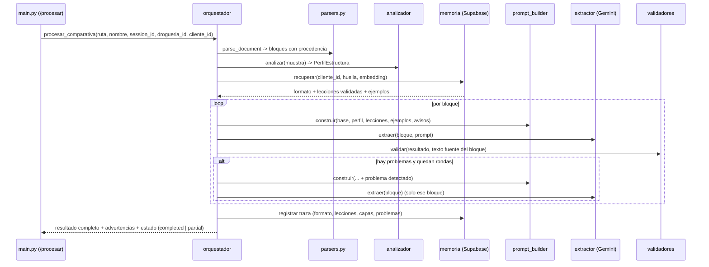
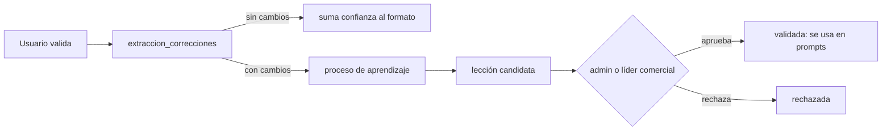

# Design: Agente de interpretación de formatos para Comparativas

## 1. Vista general



El aprendizaje corre aparte, después de la validación humana (sección 7).

## 2. Ubicación y límites

```
services/extraccion/comparativas_agente/
    __init__.py        # expone solo ejecutar(...)
    modelos.py         # PerfilEstructura, Bloque, ResultadoBloque, Problema, Traza (pydantic)
    analizador.py
    memoria.py
    prompt_builder.py
    extractor.py
    validadores.py
    orquestador.py
    aprendizaje.py
```

- `robot_comparativas.procesar_comparativa(...)` conserva su firma y delega en
  `comparativas_agente.ejecutar(...)`. `main.py` no cambia de contrato.
- El paquete pertenece a la capacidad `extraccion_ia` del mapa de módulos
  (`docs/arquitectura/mapa-modulos.md`). Puede leer tablas de negocio; negocio no lo importa.
- La captura de correcciones vive en `services/presupuestacion/extraccion/`, dueño de la
  validación. El agente solo lee `extraccion_correcciones`.
- Los dos servicios siguen comunicándose por la base, como hoy. No se agrega un endpoint entre
  ellos.
- Se agrega `tests/extraccion_agente/test_dependencias.py` (con `ast`, igual que
  `tests/pcp/test_dependencias.py`): el paquete no importa `services.presupuestacion`.

## 3. Componentes

### 3.1 Bloques con procedencia

Hoy `parse_document` devuelve un solo string. El agente necesita saber de dónde sale cada dato
para reprocesar solo lo que falló.

```python
class Bloque(BaseModel):
    indice: int
    paginas: tuple[int, int] | None   # PDF
    hoja: str | None                  # Excel / ODS
    renglon_desde: str | None
    renglon_hasta: str | None
    texto: str                        # markdown del bloque
    contexto: str                     # encabezados y lista de proveedores, repetidos en cada bloque
```

Reglas de corte:

- El corte usa el `patron_renglon` del perfil (sección 3.2), no "primera celda numérica".
- Nunca se corta un renglón entre sus proveedores.
- El tamaño se fija por salida esperada (renglones × proveedores que cotizan), no por caracteres de
  entrada.
- `contexto` va en todos los bloques, incluidas las mitades de un bloque dividido.

### 3.2 Analizador de estructura

Una llamada a Gemini con `response_schema`, sobre una muestra (primeras páginas u hoja, más una
página del medio y la última), junto con señales que ya da el parser (cantidad de columnas por
tabla, encabezados repetidos, páginas sin tabla).

```python
class PerfilEstructura(BaseModel):
    layout: Literal["proveedores_en_columnas", "proveedores_en_filas", "bloque_por_proveedor", "mixto"]
    patron_renglon: str               # regex o descripción: "^\d+$", "^R\d+", "Renglón N"
    columnas: dict[str, str]          # rol -> cómo reconocerla: renglon, descripcion, cantidad, precio_unitario, precio_total, marca
    ubicacion_marca: str              # "columna propia", "segunda línea de la descripción", "entre paréntesis"
    ubicacion_proveedor: str          # "encabezado de columna", "título sobre la tabla", "primera celda de la fila"
    proveedores: list[str]            # lista global, nombres tal como aparecen
    no_cotiza: list[str]              # textos que significan "no cotiza"
    encabezados_repetidos: bool
    tablas_partidas_entre_paginas: bool
    numeracion_reinicia_por_seccion: bool
    ambiguedades: list[str]
    confianza: float
```

Huella estructural: hash de los encabezados normalizados (minúsculas, sin acentos, sin números,
ordenados) más `layout`. Sirve para reconocer un formato ya visto sin llamar al modelo.

Si la huella coincide con un formato conocido con buena tasa de acierto, se usa el perfil guardado
y se omite la llamada de análisis.

### 3.3 Memoria

Recuperación en cascada, de más específico a más general:

1. **Formato del cliente**: `cliente_formato_documentos` por `cliente_id` + `doc_type` (lo que hoy
   hace `main.py:_buscar_formato`).
2. **Huella exacta**: `formatos_documento.huella` dentro de la droguería.
3. **Similitud** (etapa 3): pgvector sobre el embedding de la descripción del perfil, con umbral
   mínimo. Si no supera el umbral, no se recupera nada.

Devuelve: el formato, sus lecciones en estado `validada` y hasta 2 ejemplos.

### 3.4 Constructor de prompt

Capas en orden fijo, cada una con tope de tokens:

| # | Capa | Origen | Puede faltar |
|---|---|---|---|
| 1 | Reglas base | Constante versionada en código (`PROMPT_BASE_V<n>`) | No |
| 2 | Estructura de este documento | Generada desde `PerfilEstructura` con plantillas | No |
| 3 | Instrucciones del cliente | `cliente_formato_documentos.instrucciones_prompt` | Sí |
| 4 | Lecciones validadas | `formato_lecciones` | Sí |
| 5 | Ejemplos | `formato_ejemplos` | Sí |
| 6 | Avisos | `PerfilEstructura.ambiguedades` y, en reprocesos, el problema detectado | Sí |

- La capa 1 no se modifica nunca en tiempo de ejecución. Las demás agregan, no reemplazan.
- Si una lección contradice una regla base, gana la regla base y el conflicto se registra.
- La salida del modelo cambia respecto de hoy para achicar tokens: proveedores por índice, solo los
  que cotizan, `response_schema` y `temperature=0`.

```json
{"renglones": [{"renglon": "12", "ofertas": [{"p": 0, "precio": "12.50", "marca": "ELEA"}]}]}
```

### 3.5 Extractor

- Envuelve `_llamar_gemini_json` (reintentos y rotación de claves ya existentes).
- Ante truncamiento divide el bloque de forma recursiva hasta 1 renglón. Las dos mitades conservan
  `contexto`.
- Un bloque que no se pudo extraer no se reemplaza por vacío: queda como `Problema(tipo="bloque_sin_extraer")`.

### 3.6 Validadores (código, sin IA)

| Validador | Detecta | Severidad inicial |
|---|---|---|
| Cobertura | Renglones del parseo que faltan en el resultado; saltos en la numeración | Error |
| Duplicados | Mismo renglón + proveedor más de una vez con valores distintos | Error |
| Anclaje | Precio, marca o proveedor que no aparece en el texto fuente del bloque (comparando valores normalizados) | Advertencia |
| Proveedor fuera de lista | Proveedor que no está en `PerfilEstructura.proveedores` | Advertencia |
| Escala de precio | Precio muy por encima o por debajo de la mediana del renglón (posible total en vez de unitario) | Advertencia |
| Desplazamiento | Mismo precio en proveedores contiguos en muchos renglones; marca igual al nombre de un proveedor | Advertencia |
| Esquema | Precio no numérico, renglón vacío | Error |

Cada problema lleva `bloque`, `renglon`, `tipo` y `detalle`.

### 3.7 Orquestador y reproceso

- Reprocesa solo los bloques con problemas, agregando el problema a la capa 6.
- Máximo 2 rondas por bloque.
- Si quedan errores, la extracción termina en `partial` (estado que ya existe en
  `extraction_results` y es validable) con las advertencias adjuntas.
- Si no quedó ningún renglón, falla como hoy (`failed`).
- Unión entre bloques: proveedores normalizados contra la lista global del perfil; clave de renglón
  normalizada (`"1"`, `1` y `1.0` son el mismo); con `numeracion_reinicia_por_seccion`, la clave
  incluye la sección.

## 4. Datos

Todas las tablas llevan `drogueria_id`, RLS por droguería y `.down.sql` (DEC-1).

```sql
-- Dueño: extraccion_ia
CREATE TABLE formatos_documento (
    id                 UUID PRIMARY KEY DEFAULT gen_random_uuid(),
    drogueria_id       UUID NOT NULL REFERENCES droguerias (id),
    doc_type           TEXT NOT NULL,              -- 'comparativa' (deja lugar a otros tipos)
    nombre             TEXT NOT NULL,
    huella             TEXT NOT NULL,
    perfil             JSONB NOT NULL,             -- PerfilEstructura sin la lista de proveedores
    descripcion        TEXT NOT NULL,              -- texto que se embebe
    embedding          vector(768) NULL,           -- etapa 3; dimensión a confirmar según el modelo
    usos               INTEGER NOT NULL DEFAULT 0,
    validadas_sin_cambios INTEGER NOT NULL DEFAULT 0,
    activo             BOOLEAN NOT NULL DEFAULT TRUE,
    created_at         TIMESTAMPTZ NOT NULL DEFAULT NOW(),
    updated_at         TIMESTAMPTZ NOT NULL DEFAULT NOW(),
    UNIQUE (drogueria_id, doc_type, huella)
);

CREATE TABLE formato_lecciones (
    id                 UUID PRIMARY KEY DEFAULT gen_random_uuid(),
    drogueria_id       UUID NOT NULL REFERENCES droguerias (id),
    formato_id         UUID NOT NULL REFERENCES formatos_documento (id) ON DELETE CASCADE,
    instruccion        TEXT NOT NULL,              -- lo que se inyecta al prompt
    problema           TEXT NOT NULL,              -- qué error resuelve
    estado             TEXT NOT NULL DEFAULT 'candidata'
                       CHECK (estado IN ('candidata', 'validada', 'rechazada', 'retirada')),
    origen_correccion_id UUID NULL,
    aprobada_por       UUID NULL,
    aprobada_at        TIMESTAMPTZ NULL,
    usos               INTEGER NOT NULL DEFAULT 0,
    created_at         TIMESTAMPTZ NOT NULL DEFAULT NOW()
);

CREATE TABLE formato_ejemplos (
    id                 UUID PRIMARY KEY DEFAULT gen_random_uuid(),
    drogueria_id       UUID NOT NULL REFERENCES droguerias (id),
    formato_id         UUID NOT NULL REFERENCES formatos_documento (id) ON DELETE CASCADE,
    fragmento_entrada  TEXT NOT NULL,              -- con valores sintéticos
    salida_esperada    JSONB NOT NULL,             -- con valores sintéticos
    aprobado_por       UUID NULL,
    created_at         TIMESTAMPTZ NOT NULL DEFAULT NOW()
);

-- Dueño: presupuestacion/extraccion (validación)
CREATE TABLE extraccion_correcciones (
    id                 UUID PRIMARY KEY DEFAULT gen_random_uuid(),
    drogueria_id       UUID NOT NULL REFERENCES droguerias (id),
    extraction_id      UUID NOT NULL REFERENCES extraction_results (id) ON DELETE CASCADE,
    formato_id         UUID NULL,
    filas_agregadas    JSONB NOT NULL DEFAULT '[]',
    filas_eliminadas   JSONB NOT NULL DEFAULT '[]',
    filas_modificadas  JSONB NOT NULL DEFAULT '[]', -- [{clave, campo, antes, despues}]
    sin_cambios        BOOLEAN NOT NULL,
    procesada          BOOLEAN NOT NULL DEFAULT FALSE,
    validado_por       UUID NOT NULL,
    created_at         TIMESTAMPTZ NOT NULL DEFAULT NOW()
);
```

Columnas nuevas en `processing_sessions` (ya tiene `formato_usado_id`, que apunta a
`cliente_formato_documentos`):

- `formato_documento_id UUID NULL`
- `traza JSONB NULL`: versión del prompt base, capas usadas, ids de lecciones, problemas por bloque,
  rondas de reproceso.

Resultado completo: nueva columna `extraction_results.resultado_path TEXT NULL`, que apunta a un
JSON en disco junto al CSV, con todas las ofertas y las advertencias.

### Separación entre estructura y datos sensibles

| Dato | Dónde vive | Llega a un prompt |
|---|---|---|
| Perfil de estructura, lecciones | `formatos_documento`, `formato_lecciones` | Sí |
| Ejemplos | `formato_ejemplos`, con precios, marcas y proveedores reemplazados por valores sintéticos | Sí |
| Lista de proveedores del documento | Solo en memoria durante la extracción y en la traza de esa sesión | Solo en el prompt de ese mismo documento |
| Correcciones crudas (precios reales) | `extraccion_correcciones` | No. Solo las lee el proceso de aprendizaje, que devuelve una instrucción estructural |

## 5. Top 3 fuera del extractor (DEC-3)

- El extractor guarda todas las ofertas con precio válido en el JSON de resultado.
- Durante la transición el CSV se sigue escribiendo, pero con todas las ofertas ordenadas por
  renglón y precio, no solo 3.
- `_materializar_comparativa` ya calcula posiciones por precio (`_computar_posiciones`,
  `presupuestacion/extraccion/service.py:1228`), así que el orden comercial queda donde corresponde.
- Cuántas ofertas se muestran o se usan es decisión de `presupuestacion`, no del extractor.

## 6. Cambios en validación (`presupuestacion/extraccion`)

- `GET /extracciones/{id}/filas`: suma `advertencias` por renglón, leídas del JSON de resultado.
- `POST /extracciones/{id}/validar`: después de materializar, calcula la diferencia entre las filas
  extraídas y las confirmadas y la guarda en `extraccion_correcciones`. Una validación sin cambios
  se guarda con `sin_cambios = TRUE`.
- Clave de comparación de filas: `renglon` + `proveedor` normalizado.

## 7. Aprendizaje



- El proceso de aprendizaje corre fuera de línea (tarea periódica en el servicio de extracción,
  igual que `_sweep_periodico` en `main.py`). Toma correcciones no procesadas, agrupa por formato y
  pide a Gemini una instrucción estructural que hubiera evitado el error.
- La instrucción se valida en código antes de guardarla: sin números que parezcan precios, sin
  nombres de proveedores ni de clientes.
- Para ayudar a quien aprueba, se muestra el resultado de re-ejecutar la extracción con la lección
  sobre documentos ya validados de ese formato (antes y después).
- Una lección validada se retira si, después de N usos, las extracciones que la usaron requieren
  más correcciones que antes.
- Capacidades nuevas en `services/shared/permisos.py`: `formatos.lecciones.ver` y
  `formatos.lecciones.aprobar`, para admin y líder comercial (DEC-2).

## 8. Medición

- `tests/fixtures/comparativas_referencia/`: 15 a 20 comparativas reales que hoy fallan, cada una
  con su resultado esperado completo.
- `scripts/medir_comparativas.py`: corre el pipeline y reporta, por documento y en total,
  renglones recuperados, ofertas correctas (renglón + proveedor + precio), marcas correctas y
  ofertas inventadas.
- No corre en CI (usa la API real). Los tests unitarios siguen con Gemini simulado.
- Cada etapa se acepta solo si mejora la línea de base sin empeorar ningún documento.

Los archivos reales contienen datos comerciales. Antes de versionarlos hay que decidir si van al
repo o a una carpeta fuera de git (PA-3).

## 9. Costo y rendimiento

| Concepto | Hoy | Con el agente |
|---|---|---|
| Llamadas por documento | 1 por chunk | 1 de análisis (0 si la huella es conocida) + 1 por bloque + reprocesos |
| Tokens de salida | Todos los proveedores por renglón, con nombre repetido | Solo los que cotizan, por índice |
| Reintento ante falla | Chunk entero, o se pierde | Solo el bloque, máximo 2 rondas |

Se mantiene `_MAX_PARALLEL_CHUNKS = 3` y el semáforo global de `main.py`.

## 10. Puntos abiertos

| ID | Tema | Propuesta |
|---|---|---|
| PA-1 | Con todos los proveedores, comparativas grandes superan `MAX_FILAS_EDITABLES = 500` y dejan de ser editables | Agrupar por renglón en pantalla y paginar; definir en la etapa 0 antes de mover el top 3 |
| PA-2 | Modelo y dimensión de embeddings | Confirmar contra la documentación de Gemini al llegar a la etapa 3 |
| PA-3 | Dónde guardar el set de referencia | Fuera de git si contiene precios reales |
| PA-4 | Si el presupuesto de "thinking" de gemini-2.5-flash consume del límite de salida | Verificar en la documentación y fijarlo explícitamente |
| PA-5 | pgvector disponible en el proyecto Supabase | Verificar contra la base real; no se pudo consultar al escribir este diseño |
